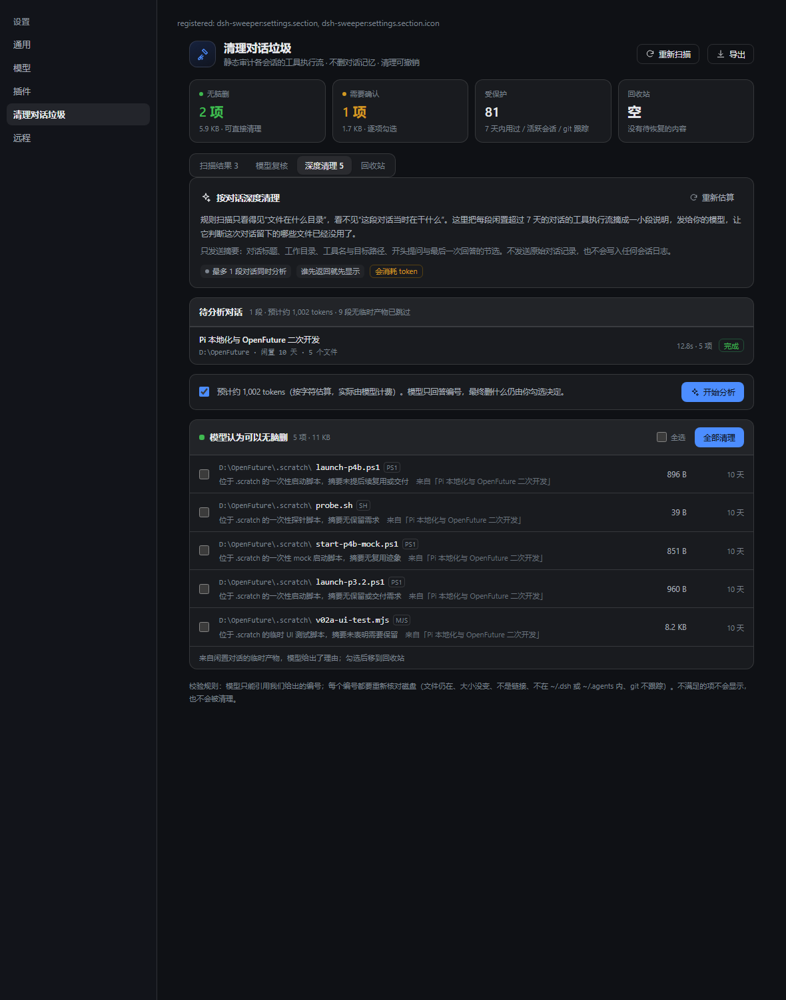
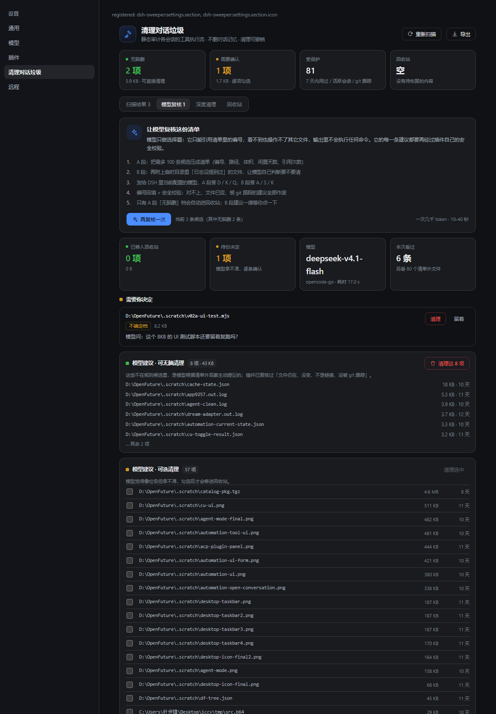

# 验证记录

这份文档记录「模型给出的候选，真的会出现在设置页上」这件事是怎么验证的，以及**哪些部分是自动化的、哪一部分需要人在桌前点**。

## 一条必须说清楚的分界

| 验证方式 | 覆盖什么 | 不覆盖什么 |
| --- | --- | --- |
| 宿主内自测（`selftest.json` 触发） | 真实会话日志 → 真实模型调用 → 真实校验 → 真实 JSON | 界面渲染 |
| 真浏览器回放（`test/browser`） | 用**同一份 `client.js`** 渲染上面抓到的真实 JSON | Electron 窗口里的点击 |
| 桌面对点（computer use） | 真实窗口里点一遍 | —— **本次未能完成**（执行期间桌面一直处于锁屏） |

所以下面这些截图与数字，证明的是「服务端产物正确」+「同一份前端代码能把它正确画出来」，不等于「有人在 Electron 里亲手点过」。最后一步留给有解锁桌面的人。

## 证据

### 深度清理：真实模型判定落到页面



- 会话：`PI 本地化与 OpenFuture 二次开发`，目录 `D:\OpenFuture`，闲置 10 天，5 个文件
- 模型：`opencode-go / deepseek-v4.1-flash`，12.8 秒，估算约 1,002 tokens
- 结果：5 项全部判为「可以无脑删」，每条都带模型自己写的理由（例如「39 字节的一次性探针脚本，摘要无保留需求」）
- 页面底部一行是小字校验规则：编号要重新对磁盘、大小/mtime 变了、是链接、在 `~/.dsh`/`~/.agents` 里、被 git 跟踪的，一律不显示也不会被清理

### 模型复核：真实判定 + 反问



- 同一份真实响应里，5 条自动进回收站、1 条模型反问「这个 8KB 的 UI 测试脚本还要留着复跑吗？」，另有清单外文件 8 项「可无脑清理」、57 项「可选清理」

### 逐条返回：谁先返回先显示

`test/browser` 的合成模式让第 2、3、1 段对话按 4/2/3 的轮询顺序完成：

| 轮询 | 状态 |
| --- | --- |
| 第 2 次 | 第 2 段 `done`，其它 `queued` |
| 第 3 次 | 第 3 段 `done` |
| 第 4 次 | 第 1 段 `done` |

页面不是「最后一起刷」，而是每段完成就单独更新那一行。

## 复现

```bash
# 1) 服务端：宿主机内跑一遍（会真实调用模型，consent 必须显式）
echo '{"go":true,"deep":true,"sessions":1,"concurrency":1}' > "$HOME/.dsh/plugin-data/dsh-sweeper/selftest.json"
# 然后停用再启用插件；结果写到同一目录的 selftest-out.json

# 2) 页面：用上面抓到的真实响应回放
REAL=1 PORT=8745 node test/browser/server.mjs
chrome --headless=new --window-size=1180,1500 --virtual-time-budget=16000 \
  --screenshot=out.png "http://127.0.0.1:8745/?stop=12000"
```

`test/browser/check.mjs` 是其中一条的自动化版本：复核结束后那次报告刷新落地之后，判定卡片必须还在屏幕上（v1.2.5 曾丢掉过，见 `方案.md` §16.3）。

## 期间被真实数据抓出来的 10 个 bug

1. `deep` 从未声明 → 首次发布报告就 500
2. 自测路由带 query 找不到
3. `mergeDeep` 没聚合 `rejected` → `concat` of undefined
4. `deepVet` 把数字当候选数组 → 行永远停在 `queued`，且被 `catch {}` 静默吞掉
5. 候选路径用了归一化后的小写 key → 页面显示 `d:\openfuture\...`
6. 老会话日志头没有 `cwd` → 列表显示「未知目录」
7. 复核结果刚渲染就被刷新清空
8. `模型问：undefined`
9. 点「停止」只改状态，token 照烧
10. `normKey` 不归一化尾斜杠 → `isInside` 边界判断可被绕过
11. `maxSessions` 的裁剪被写回规划缓存 → 测试跑完后页面「只剩 1 段对话」持续一分钟
12. 模型读报告期间重扫 → 判定仍按旧列表执行（现在直接 409，什么都不动）
13. 客户端中途断开 → `readBody` 的 Promise 永远不 settle
14. 一段日志打不开 → 整份深度计划 500（现在只跳过那一段并计数）

前 8 个都只在「真实日志 + 真实模型 + 真渲染」这条路上才现形。
